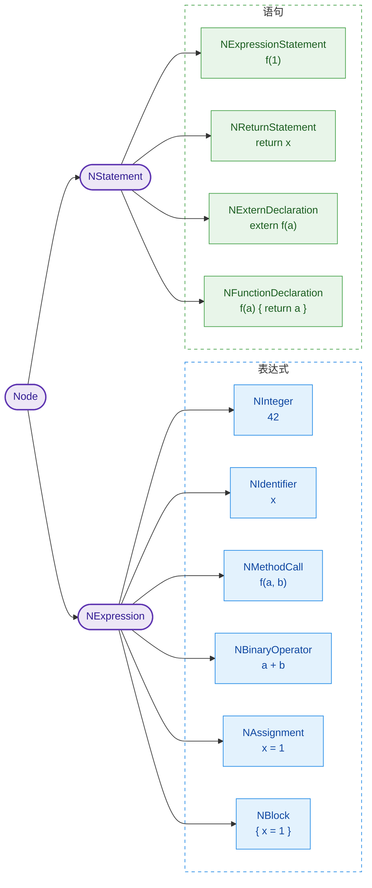

# 实现一个简单的编译器

简单的说 `编译器` 就是语言翻译器，它一般将高级语言翻译成更低级的语言，如 GCC 可将 C/C++ 语言翻译成可执行机器语言，Java 编译器可以将 Java 源代码翻译成 Java 虚拟机可以执行的字节码。

编译器如此神奇，那么它到底是如何工作的呢？本文将简单介绍编译器的原理，并实现一个简单的编译器，使它能编译我们自定义语法格式的源代码。（文中使用的源码都已上传至 [GitHub](https://github.com/shdxiang/xy-compiler) 以方便查看）。

## 快速开始

安装好[依赖项](#依赖项安装)后，在源码目录下执行：

```bash
cmake -S . -B build
cmake --build build
./build/bin/xy-compiler src/demo/demo.xy    # 输出 11
ctest --test-dir build --output-on-failure  # 运行测试
```

## 目录

- [自定义语法](#自定义语法)
- [编译原理简介](#编译原理简介)
- [工具简介](#工具简介)
- [词法分析器](#词法分析器)
- [语法分析器](#语法分析器)
- [目标码生成](#目标码生成)
- [编译测试](#编译测试)
- 附录：[命令行用法](#命令行用法) · [语言参考](#语言参考) · [项目结构](#项目结构) · [开发](#开发)

## 自定义语法

为了简洁易懂，我们的编译器将只支持以下简单功能：

- 数据类型只支持整型（64 位有符号整数），这样不需要数据类型符；

- 支持 `加（+）`，`减（-）`，`乘（*）`，`除（/）` 运算；

- 支持 `等于（==）`，`不等于（!=）` 比较运算，结果为 `1` 或 `0`；

- 支持变量赋值（`x = 1`）、函数定义和函数调用；

- 支持 `extern` 声明外部函数（为了调用运行时库中的 `printi` 打印计算结果）；

- 支持 `//` 单行注释。

完整的语法和语义说明见附录[语言参考](#语言参考)。

以下是我们要支持的源码实例 [demo.xy](src/demo/demo.xy)：

```c
extern printi(val)

sum(a, b) {
  return a + b
}

mult(a, b) {
  return a * b
}

printi(mult(4, 5) - sum(4, 5))
```

## 编译原理简介

一般编译器有以下工作步骤：

1. **词法分析（Lexical analysis）：** 此阶段的任务是从左到右一个字符一个字符地读入源程序，对构成源程序的字符流进行扫描然后根据构词规则识别 `单词（Token）`，完成这个任务的组件是 `词法分析器（Lexical analyzer，简称Lexer）`，也叫 `扫描器（Scanner）`；

1. **语法分析（Syntactic analysis，也叫 Parsing）：** 此阶段的主要任务是由 `词法分析器` 生成的单词构建 `抽象语法树（Abstract Syntax Tree ，AST）`，完成此任务的组件是 `语法分析器（Parser）`；

1. **目标码生成：** 此阶段编译器会遍历上一步生成的抽象语法树，然后为每个节点生成 `机器 / 字节码`。

编译器完成编译后，由 `链接器（Linker）` 将生成的目标文件链接成可执行文件，这一步并不是必须的，一些依赖于虚拟机运行的语言（如 Java，Erlang）就不需要链接。

## 工具简介

### 使用的工具

对应编译器的工作步骤，我们将使用以下工具，括号里标明了所需的版本：

- **[Flex（2.6+）](https://github.com/westes/flex)：** Flex 是 Lex 的开源替代品，它们都是 `词法分析器` 制作工具，它可以根据我们定义的规则生成 `词法分析器` 的代码；

- **[Bison（3+）](https://www.gnu.org/software/bison/)：** Bison 是 `语法分析器` 的制作工具，同样它可以根据我们定义的规则生成 `语法分析器` 的代码；

- **[LLVM（14+）](http://llvm.org/)：** LLVM 是构建编译器的框架系统，我们会利用它来完成从 `抽象语法树` 生成目标码的过程。

- **[winflexbison](https://github.com/LonghronShen/winflexbison)：** 在 Windows 上使用从源码构建的基于 CMake 的 Bison 和 Flex 实现。

- **[CMake（3.21+）](https://cmake.org)：** 本项目使用 CMake 实现跨平台构建。

### 依赖项安装

1. Linux

   以 Ubuntu 为例，可以通过以下命令安装这些工具：

   ```bash
   apt-get update
   apt-get install -y git build-essential cmake ninja-build flex bison llvm-dev \
       zlib1g-dev libzstd-dev libedit-dev libxml2-dev libffi-dev libncurses-dev
   ```

   也可以直接运行 [scripts/bootstrap.sh](scripts/bootstrap.sh)。

2. macOS

   使用 **Homebrew** 安装依赖项：

   ```bash
   brew install llvm cmake flex bison
   ```

   配置时需要告诉 CMake LLVM 的位置：

   ```bash
   cmake -S . -B build -DLLVM_DIR=$(brew --prefix llvm)/lib/cmake/llvm
   ```

3. Windows

   Flex 和 Bison 不需要单独安装，构建时会自动下载并编译 [winflexbison](https://github.com/LonghronShen/winflexbison)。

   - **CMake：**

     使用官方下载页面的 [msi 安装包](https://github.com/Kitware/CMake/releases/download/v3.21.2/cmake-3.21.2-windows-x86_64.msi)，或者使用 **Visual Studio 2017** 及以上版本自带的 CMake

   - **Visual Studio：**

     推荐使用 2019 及以上版本

   - **LLVM：**

     使用预编译的 [LLVM 包](https://ziglang.org/deps/llvm%2bclang%2blld-12.0.1-rc1-x86_64-windows-msvc-release-mt.tar.xz)，或者使用 [vcpkg](https://github.com/microsoft/vcpkg) 安装

介绍完工具，现在我们可以开始实现我们的编译器了。

## 词法分析器

前面提到 `词法分析器` 要将源程序分解成 `单词`，我们的语法格式很简单，只包括：标识符，数字，数学运算符，括号和大括号等，我们将通过 Flex 来生成 `词法分析器` 的源码，给 Flex 使用的规则文件 [lexical.l](src/parser/lexical.l) 如下：

```lex
%{
#include <string>
#include "ast.h"
#include "syntactic.hpp"

#define SAVE_TOKEN  yylval.string = new std::string(yytext, yyleng)
#define TOKEN(t)    (yylval.token = t)
%}

%option noyywrap nounput noinput yylineno

%%

[ \t\r\n]               ;
"//".*                  ;
"extern"                return TOKEN(TEXTERN);
"return"                return TOKEN(TRETURN);
[a-zA-Z_][a-zA-Z0-9_]*  SAVE_TOKEN; return TIDENTIFIER;
[0-9]+                  SAVE_TOKEN; return TINTEGER;

"="                     return TOKEN(TEQUAL);
"=="                    return TOKEN(TCEQ);
"!="                    return TOKEN(TCNE);

"("                     return TOKEN(TLPAREN);
")"                     return TOKEN(TRPAREN);
"{"                     return TOKEN(TLBRACE);
"}"                     return TOKEN(TRBRACE);

","                     return TOKEN(TCOMMA);

"+"                     return TOKEN(TPLUS);
"-"                     return TOKEN(TMINUS);
"*"                     return TOKEN(TMUL);
"/"                     return TOKEN(TDIV);

.                       return TOKEN(TINVALID);

%%

```

我们来解释一下，这个文件被 2 个 `%%` 分成 3 部分，第 1 部分用 `%{` 与 `%}` 包括的是一些 C++ 代码，会被原样复制到 Flex 生成的源码文件中，还可以在这里指定一些选项，如我们使用了 `%option noyywrap`（不需要 `yywrap()` 函数）和 `yylineno`（记录行号，用于报错），也可以在这定义宏供后面使用；第 2 部分用来定义构成单词的规则，可以看到每条规则都是一个 `正则表达式` 和 `动作`，很直白，就是 `词法分析器` 发现了匹配的 `单词` 后执行相应的 `动作` 代码，大部分只要返回 `单词` 给调用者就可以了；第 3 部分可以定义一些函数，也会原样复制到生成的源码中去，这里我们留空没有使用。遇到无法识别的字符时，我们返回 `TINVALID`，让 `语法分析器` 报告语法错误并停止编译。

现在我们可以通过调用 Flex 生成 `词法分析器` 的源码：

```bash
flex -o lexical.cpp lexical.l
```

生成的 `lexical.cpp` 里会有一个 `yylex()` 函数供 `语法分析器` 调用；你可能发现了，有些宏和变量并没有被定义（如 `TEXTERN`，`yylval`，`yytext` 等），其实有些是 Flex 会自动定义的内置变量（如 `yytext`），有些是后面 `语法分析器` 生成工具里定义的变量（如 `yylval`），我们后面会看到。

## 语法分析器

`语法分析器` 的作用是构建 `抽象语法树`，通俗的说 `抽象语法树` 就是将源码用树状结构来表示，每个节点都代表源码中的一种结构；对于我们要实现的语法，语法树的节点类型很简单，它们都定义在 [ast.h](src/parser/ast.h) 中，继承关系如下：



现在我们使用 Bison 生成 `语法分析器` 代码，同样 Bison 需要一个规则文件 [syntactic.y](src/parser/syntactic.y)。是不是发现和 Flex 的规则文件很像呢？确实是这样，它也由 `%%` 分隔的 3 个部分组成，下面我们分别摘取每个部分的代码看一下，完整内容可以通过链接查看。

第 1 部分是声明。`%code` 块中的 C++ 代码会被原样复制到生成的源文件中；`%union` 列出了分析过程中各个符号的值可能的类型；`%token` 则定义了前面 Flex 使用的单词（如 `TLPAREN`）：

```yacc
%union {
    NBlock *block;
    NExpression *expr;
    NStatement *stmt;
    NIdentifier *ident;
    VariableList *varvec;
    ExpressionList *exprvec;
    std::string *string;
    int token;
}

/* Define our terminal symbols (tokens). This should
   match our lexical.l lex file. We also define the node type
   they represent.
 */
%token <string> TIDENTIFIER "identifier" TINTEGER "integer"
%token <token> TCEQ "==" TCNE "!=" TEQUAL "="
%token <token> TLPAREN "(" TRPAREN ")" TLBRACE "{" TRBRACE "}" TCOMMA ","
%token <token> TPLUS "+" TMINUS "-" TMUL "*" TDIV "/"
%token <token> TRETURN "return" TEXTERN "extern"
%token <token> TINVALID "invalid character"
```

单词名后面引号里的是它的别名，Bison 报告语法错误时会用别名代替单词名，如 `unexpected ), expecting identifier`。

运算符的优先级也在这一部分声明，越靠后的优先级越高：

```yacc
/* Operator precedence, from lowest to highest */
%precedence TEQUAL
%nonassoc TCEQ TCNE
%left TPLUS TMINUS
%left TMUL TDIV
/* An identifier followed by "(" is always a call, never a variable
   followed by a parenthesized expression statement */
%precedence VARIABLE
%precedence TLPAREN
```

最后两行解决了一个歧义：语句之间没有分隔符，`f (x)` 既可以理解成调用 `f(x)`，也可以理解成变量 `f` 后面跟着一个表达式 `(x)`，这里规定标识符后面跟 `(` 时总是函数调用。

第 2 部分是语法规则。不像 Flex 通过 `正则表达式` 定义规则，这里使用的是 `巴科斯范式（BNF: Backus-Naur Form）` 的形式定义了我们识别的语法结构。例如程序由一系列语句组成，语句有 4 种：

```yacc
program:
  stmts { programBlock = $1; }
;

stmts:
  %empty { $$ = new NBlock(); }
| stmts stmt { $1->statements.emplace_back($2); $$ = $1; }
;

stmt:
  func_decl
| extern_decl
| expr { $$ = new NExpressionStatement($1); }
| TRETURN expr { $$ = new NReturnStatement($2); }
;
```

规则后面大括号中间的是 `动作` 代码，`$$` 表示规则左边符号的值，`$1`、`$2` 等依次表示右边各个符号的值。上面的动作就是在 `抽象语法树` 中生成相应的节点。再看看表示函数定义的规则：

```yacc
/* The parameter list is parsed as call_args so the parser does not have to
   decide between a declaration and a call before it sees the "{" */
func_decl:
  ident TLPAREN call_args TRPAREN block {
      VariableList params;
      if (!toParameters(*$3, params)) {
          actionError($1->line, "function parameters must be identifiers");
          delete $1; delete $3; delete $5;
          YYERROR;
      }
      $$ = new NFunctionDeclaration($1, std::move(params), $5);
      delete $3;
  }
;
```

注意这里的参数列表用的是和函数调用相同的 `call_args`：`语法分析器` 只向前看一个单词，读到 `f(a` 时还无法判断这是函数定义还是函数调用 `f(a)`，要等到看见 `{` 才能确定，所以先统一按调用参数解析，确认是函数定义后再用第 1 部分 `%code` 块中定义的 `toParameters` 检查每个参数都是标识符：

```c++
/* Function parameters are parsed like call arguments (see func_decl);
   this checks that every argument is a plain identifier. */
static bool toParameters(ExpressionList &args, VariableList &params) {
    for (auto &arg : args) {
        if (!dynamic_cast<NIdentifier *>(arg.get())) {
            return false;
        }
    }
    for (auto &arg : args) {
        params.emplace_back(static_cast<NIdentifier *>(arg.release()));
    }
    return true;
}
```

构建时 Bison 若发现语法规则有冲突（也就是有歧义）会直接报错。

第 3 部分是 `yyerror` 函数，`语法分析器` 遇到语法错误时会调用它，我们在错误信息中加上了行号和出错位置的单词：

```c++
void yyerror(const char *s) {
    if (yychar == YYEOF || yychar == YYEMPTY) {
        std::fprintf(stderr, "line %d: error: %s\n", yylineno, s);
    } else {
        std::fprintf(stderr, "line %d: error: %s, near '%s'\n", yylineno, s, yytext);
    }
}
```

像 `NFunctionDeclaration` 这样的节点类是我们自己定义的，它们都在 [ast.h](src/parser/ast.h) 中。所有节点都继承自 `Node`：

```c++
/* Base class of all AST nodes. Each node owns its children, so deleting the
   root block frees the whole tree. `line` is the source line used in error
   messages. */
class Node {
public:
  int line = yylineno;
  virtual ~Node() = default;
  virtual llvm::Value *codeGen(CodeGenContext &context) = 0;
};
```

函数定义节点如下：

```c++
class NFunctionDeclaration : public NStatement {
public:
  std::unique_ptr<NIdentifier> id;
  VariableList arguments;
  std::unique_ptr<NBlock> block;
  NFunctionDeclaration(NIdentifier *id, VariableList &&arguments, NBlock *block)
      : id(id), arguments(std::move(arguments)), block(block) {
    line = this->id->line;
  }
  llvm::Value *codeGen(CodeGenContext &context) override;
};
```

可以看到，它有 `标识符（id）`，`参数列表（arguments）`，`函数体（block）` 这些成员（用 `std::unique_ptr` 持有，节点释放时子节点也随之释放），在语法分析阶段会设置好这些成员的内容供后面的 `目标码生成` 阶段使用。还可以看到每个节点都有一个 `codeGen()` 虚函数，你可能猜到了，后面就是通过调用它来生成相应的目标代码。

我们可以通过以下命令调用 Bison 生成 `语法分析器` 的源码文件，这里我们使用 `-d` 使头文件和源文件分开，因为前面 `词法分析器` 的源码使用了这里定义的一些宏，所以需要使用这个头文件，这里将会生成 `syntactic.cpp` 和 `syntactic.hpp`：

```bash
bison -d -o syntactic.cpp syntactic.y
```

## 目标码生成

这是最后一步了，这一步的主角是前面提到 LLVM，LLVM 是一个构建编译器的框架系统，我们使用它遍历 `语法分析` 阶段生成的 `抽象语法树`，然后为每个节点生成相应的 `目标码`。当然，无法避免的是我们需要使用 LLVM 提供的函数来编写生成目标码的源码，就是实现前面提到的虚函数 `codeGen()`，是不是有点拗口？不过确实是这样。我们在 [gen.cpp](src/compiler/gen.cpp) 中编写了不同节点的生成代码，例如函数调用节点的生成代码：

```c++
Value *NMethodCall::codeGen(CodeGenContext &context) {
  context.trace("Creating method call: " + id->name);
  Function *function = context.module->getFunction(id->name);
  if (!function || context.isEntryFunction(function)) {
    throw CodeGenError(line, "call to undefined function '" + id->name + "'");
  }
  if (function->arg_size() != arguments.size()) {
    throw CodeGenError(line, "function '" + id->name + "' expects " +
                                 std::to_string(function->arg_size()) +
                                 " argument(s), got " +
                                 std::to_string(arguments.size()));
  }
  std::vector<Value *> args;
  for (auto &argument : arguments) {
    args.push_back(argument->codeGen(context));
  }
  return context.builder.CreateCall(function, args);
}
```

看起来有点复杂，简单来说就是通过 LLVM 提供的 `IRBuilder` 接口来生成 `目标码`；遇到调用不存在的函数、参数个数不对、使用未赋值的变量等错误时，会抛出带行号的 `CodeGenError`。生成完毕后还会用 LLVM 的 `verifyModule` 检查生成的代码是否合法。需要了解更多的话可以去 LLVM 的官网学习一下。

至此，我们所有的工作基本都做完了。简单回顾一下：我们先通过 Flex 生成 `词法分析器` 源码文件 `lexical.cpp`，然后通过 Bison 生成 `语法分析器` 源码文件 `syntactic.cpp` 和头文件 `syntactic.hpp`，我们自己编写了 `抽象语法树` 节点定义文件 [ast.h](src/parser/ast.h) 和 `目标码` 生成文件 [gen.cpp](src/compiler/gen.cpp)，还有一个 [gen.h](src/compiler/gen.h) 包含一点 LLVM 环境相关的代码，为了输出我们程序的结果，还在 [printi.cpp](src/runtime/implementation/system/console/printi.cpp) 里简单的通过调用 C 语言库函数实现了输出一个整数（我们语言中的函数都返回整数，所以它返回传入的值）。

对了，我们还需要一个 `main` 函数作为编译器的入口函数，它在 [main.cpp](src/compiler/main.cpp) 里。`main` 函数解析命令行参数、打开输入文件后，调用 `compileAndRun` 完成编译和运行：

```c++
/* Parse the program from yyin, compile it, then run it with the JIT */
static int compileAndRun(const cxxopts::ParseResult &args) {
  yydebug = args.count("debug") ? 1 : 0;
  int parseResult = yyparse();
  if (yyin != stdin) {
    std::fclose(yyin);
  }
  if (parseResult != 0 || !programBlock) {
    return 1;
  }
  std::unique_ptr<NBlock> program(programBlock);
  programBlock = nullptr;

  llvm::InitializeNativeTarget();
  llvm::InitializeNativeTargetAsmPrinter();
  llvm::InitializeNativeTargetAsmParser();

  CodeGenContext context(args.count("verbose") > 0);
  try {
    context.generateCode(*program);
  } catch (const CodeGenError &ex) {
    std::cerr << "line " << ex.line << ": error: " << ex.what() << std::endl;
    return 1;
  } catch (const std::exception &ex) {
    std::cerr << "internal error: " << ex.what() << std::endl;
    return 1;
  }

  if (args.count("output") &&
      !writeIR(context, args["output"].as<std::string>())) {
    return 1;
  }
  if (args.count("no-run")) {
    return 0;
  }

  /* Make the symbols of this process (including libxy) visible to the JIT */
  llvm::sys::DynamicLibrary::LoadLibraryPermanently(nullptr);
  try {
    return static_cast<int>(context.runCode());
  } catch (const std::exception &ex) {
    std::cerr << "error: " << ex.what() << std::endl;
    return 1;
  }
}
```

我们可以看到其调用了 `yyparse()` 做 `语法分析`（`yyparse()` 内部会先调用 `yylex()` 做 `词法分析`）；然后是一系列的 LLVM 初始化代码，`context.generateCode(*program)` 开始生成 `目标码`；最后是 `context.runCode()` 来运行代码，这里使用了 LLVM 的 `JIT（Just In Time）` 来直接运行代码，没有链接的过程。顶层的 `return` 语句的值会作为进程的退出码。

现在我们可以用这些文件生成我们的编译器了，需要说明一下，因为 `词法分析器` 的源码使用了一些 `语法分析器` 头文件中的宏，所以正确的生成顺序是这样的：

```bash
bison -d -o syntactic.cpp syntactic.y
flex -o lexical.cpp lexical.l
```

然后将生成的源文件和其他源文件一起编译，并链接 LLVM 库。具体的编译选项比较繁琐，我们交给 CMake 处理。如果你下载了 [GitHub](https://github.com/shdxiang/xy-compiler) 的源码，那么直接在源码目录下：

```bash
cmake -S . -B build
cmake --build build
```

就可以完成以上过程了。如果安装了多个版本的 LLVM，可以通过 `-DLLVM_DIR=/usr/lib/llvm-18/lib/cmake/llvm` 这样的参数指定使用哪一个。正常会在 `./build/bin` 目录下生成一个二进制文件 `xy-compiler`，它就是我们的编译器了。

运行测试的方法见附录[开发](#开发)。

## 编译测试

我们使用之前提到的实例 [demo.xy](src/demo/demo.xy) 来测试，可以将源文件作为参数传给 `xy-compiler`，也可以通过标准输入传入：

```bash
cd ./build/bin
./xy-compiler demo.xy
cat demo.xy | ./xy-compiler
```

输出如下：

```bash
11
```

可以看到正确输出了期望的结果。我们还可以查看生成的 LLVM IR（其他选项见附录[命令行用法](#命令行用法)）：

```bash
./xy-compiler --no-run -o - demo.xy
```

```llvm
; ModuleID = 'main'
source_filename = "main"

define i64 @main() {
entry:
  %0 = call i64 @mult(i64 4, i64 5)
  %1 = call i64 @sum(i64 4, i64 5)
  %2 = sub i64 %0, %1
  %3 = call i64 @printi(i64 %2)
  ret i64 0
}

declare i64 @printi(i64)

define internal i64 @sum(i64 %a, i64 %b) {
entry:
  %a.addr = alloca i64, align 8
  %b.addr = alloca i64, align 8
  store i64 %a, ptr %a.addr, align 4
  store i64 %b, ptr %b.addr, align 4
  %a1 = load i64, ptr %a.addr, align 4
  %b2 = load i64, ptr %b.addr, align 4
  %0 = add i64 %a1, %b2
  ret i64 %0
}

define internal i64 @mult(i64 %a, i64 %b) {
entry:
  %a.addr = alloca i64, align 8
  %b.addr = alloca i64, align 8
  store i64 %a, ptr %a.addr, align 4
  store i64 %b, ptr %b.addr, align 4
  %a1 = load i64, ptr %a.addr, align 4
  %b2 = load i64, ptr %b.addr, align 4
  %0 = mul i64 %a1, %b2
  ret i64 %0
}
```

源码有错误时，编译器会报告错误所在的行并以非 0 退出码退出：

```bash
$ echo 'printi(1)' | ./xy-compiler
line 1: error: call to undefined function 'printi'
```

至此我们简单的编译器就完成了。

## 命令行用法

```text
xy-compiler [选项] [文件]
```

不指定文件时从标准输入读取源码。编译成功后会通过 JIT 直接运行程序。

| 选项 | 说明 |
| --- | --- |
| `-f, --file <文件>` | 输入文件，等同于直接写文件名 |
| `-o, --output <文件>` | 把生成的 LLVM IR 写入文件，`-` 表示标准输出 |
| `-n, --no-run` | 只编译，不运行程序 |
| `-v, --verbose` | 在标准错误输出中打印代码生成的过程 |
| `-d, --debug` | 在标准错误输出中打印 `语法分析器` 的分析过程 |
| `--version` | 打印编译器和运行时库的版本 |
| `-h, --help` | 打印帮助 |

退出码：

| 退出码 | 含义 |
| --- | --- |
| `0` | 编译运行成功（程序没有顶层 `return`） |
| 程序的返回值 | 程序执行了顶层的 `return` 语句 |
| `1` | 源码有错误，或输入、输出文件无法打开 |
| `2` | 命令行参数错误 |

错误信息输出到标准错误，格式为 `line <行号>: error: <描述>`。

## 语言参考

### 词法

- 标识符：`[a-zA-Z_][a-zA-Z0-9_]*`，关键字 `extern` 和 `return` 除外；
- 整数：十进制数字，取值范围是 64 位有符号整数，超出范围是编译错误；没有负数字面量，也没有一元负号，负数可以写成 `0 - 1`；
- 注释：从 `//` 到行尾；
- 空格、制表符和换行（包括 Windows 的 `\r\n`）都只是分隔符。

### 语句

程序由一系列语句组成，语句之间不需要分号或换行分隔：

| 语句 | 说明 |
| --- | --- |
| `表达式` | 计算表达式的值 |
| `return 表达式` | 从当前函数返回；在顶层使用时结束程序，返回值作为进程退出码 |
| `名称(参数, ...) { 语句 ... }` | 定义函数，参数只能是标识符 |
| `extern 名称(参数, ...)` | 声明外部函数 |

### 表达式

| 表达式 | 说明 |
| --- | --- |
| `123` | 整数 |
| `x` | 读取变量 |
| `x = 表达式` | 给变量赋值，变量不存在时创建它；整个表达式的值就是所赋的值 |
| `f(参数, ...)` | 调用函数，参数从左到右求值 |
| `a + b` 等 | 二元运算，两个操作数从左到右求值 |
| `(表达式)` | 括号 |

运算符的优先级从高到低：

| 运算符 | 结合性 |
| --- | --- |
| `*` `/` | 左结合 |
| `+` `-` | 左结合 |
| `==` `!=` | 不可结合（`a == b == c` 是语法错误） |
| `=` | 右结合（`a = b = 1`） |

### 语义

- 所有的值都是 64 位有符号整数，溢出时按二进制补码回绕；
- 除法向零取整（`(0 - 7) / 2` 等于 `-3`），除以 0 是未定义行为（在 x86 上程序通常会崩溃）；
- `==` 和 `!=` 的结果是 `1` 或 `0`；
- 每个函数（包括顶层代码）都有自己独立的变量，函数内看不到顶层的变量；参数按值传递；读取从未赋值的变量是编译错误；
- 函数必须先定义或声明再调用，参数个数必须一致；在函数体内定义的函数和顶层定义的函数一样是全局的，但不能访问外层函数的变量；
- 函数的返回值是执行到的第一个 `return` 的值，没有执行 `return` 时返回 `0`，`return` 之后的语句不会执行；
- 名称 `main` 被保留给程序的入口函数，不能用作函数名；
- `extern` 声明的函数在运行时按名称在编译器进程中查找，它的参数和返回值都应该是 `long long`。运行时库 [libxy](src/runtime) 提供了 `printi(val)`，它打印 `val` 和换行，然后返回 `val`。

## 项目结构

| 路径 | 说明 |
| --- | --- |
| [src/parser/lexical.l](src/parser/lexical.l) | 词法规则（Flex） |
| [src/parser/syntactic.y](src/parser/syntactic.y) | 语法规则（Bison） |
| [src/parser/ast.h](src/parser/ast.h) | 抽象语法树的节点 |
| [src/compiler/gen.h](src/compiler/gen.h)、[gen.cpp](src/compiler/gen.cpp) | 目标码生成和 JIT 运行 |
| [src/compiler/main.cpp](src/compiler/main.cpp) | 命令行入口 |
| [src/runtime](src/runtime) | 运行时库 libxy（`printi` 和版本信息） |
| [src/demo/demo.xy](src/demo/demo.xy) | 示例程序 |
| [tests](tests) | 测试用例和测试脚本 |
| [external/InitializeExternalComponents.cmake](external/InitializeExternalComponents.cmake) | 查找或下载依赖项（LLVM、cxxopts，以及 Windows 上的 winflexbison） |
| [cmake](cmake) | CMake 模块 |
| [scripts](scripts) | 安装依赖项（`bootstrap.sh`）和格式化代码（`format.sh`）的脚本 |

## 开发

### 构建选项

| CMake 选项 | 默认值 | 说明 |
| --- | --- | --- |
| `CMAKE_BUILD_TYPE` | `Release` | 构建类型，如 `Debug` |
| `LLVM_DIR` | 自动查找 | LLVM 的 CMake 配置目录，如 `/usr/lib/llvm-18/lib/cmake/llvm` |
| `XY_BUILD_TESTS` | `ON` | 是否构建测试 |
| `COMPILE_DEMO` | `OFF` | 构建时把 `demo.xy` 编译成 `build/bin/demo.ll` |

### 测试

```bash
ctest --test-dir build --output-on-failure
```

测试用例在 [tests/cases](tests/cases) 目录下，每个 `.xy` 文件就是一个测试，在注释中写明期望的结果：

```c
// expect-stdout: 3
// expect-exit: 0
extern printi(val)
printi(1 + 2)
```

- `// expect-stdout:` 期望的一行标准输出，可以写多行，标准输出必须与之完全一致；
- `// expect-stderr:` 标准错误中应该包含的内容，不写时标准错误必须为空；
- `// expect-exit:` 期望的退出码，默认为 `0`。

新增的 `.xy` 文件会被自动加入测试（需要重新运行一次 CMake 配置）。命令行相关的测试在 [tests/CMakeLists.txt](tests/CMakeLists.txt) 中。

### 代码格式

C++ 代码使用 [.clang-format](.clang-format) 中的 LLVM 风格：

```bash
scripts/format.sh          # 格式化
scripts/format.sh --check  # 只检查，CI 中会运行
```

可以通过 `CLANG_FORMAT` 环境变量指定 clang-format 的路径，CI 使用的是 `clang-format-18`。

### 持续集成

[GitHub Actions](.github/workflows/ci.yml) 会检查代码格式，并在 Ubuntu 上分别使用 LLVM 14 和 18 构建并运行测试。

## 参考

- [Writing an Interpreter with Lex, Yacc, and Memphis](http://memphis.compilertools.net/interpreter.html)

- [Lex & Yacc Tutorial](http://epaperpress.com/lexandyacc/)

- [Writing Your Own Toy Compiler Using Flex, Bison and LLVM](http://gnuu.org/2009/09/18/writing-your-own-toy-compiler)

- [Kaleidoscope: Implementing a Language with LLVM](http://llvm.org/docs/tutorial/index.html#kaleidoscope-implementing-a-language-with-llvm)

## 许可证

[MIT](LICENSE)
